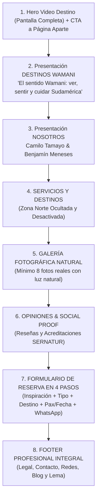

# Auditoría Integral UX/UI & Front-end: Wamani Experience
**Basada estrictamente en el Manual de Marca Oficial de Wamani Experience**

---

## 1. Resumen Ejecutivo de la Auditoría

Como equipo multidisciplinario de **UX Research, UI Design y Front-end Engineering**, se analizó la arquitectura de información, la coherencia cromática, la jerarquía visual y la experiencia de conversión del sitio web de **Wamani Experience**.

### Diagnóstico de Brechas Principales:
1. **Divergencia Cromática:** El sitio implementaba un fondo turquesa saturado (`#2BA59A`), verde bosque oscuro (`#045D56`) y cian neón (`#2DD4BF`), alejándose de la sobriedad y pureza del Manual: **Verde Wamani (`#147E79`)**, **Blanco Andino (`#FFFFFF`)**, **Gris Piedra (`#4C4C4C`)** y **Beige Tierra (`#E7DCC3`)**.
2. **Jerarquía Tipográfica:** Se utilizaba masivamente una tipografía manuscrita casual (`Caveat`) en los encabezados principales, lo que restaba legitimidad institucional. El manual oficial prescribe **Montserrat** para toda la jerarquía de títulos y textos, reservando **Playfair Display** exclusivamente para citas poéticas y eslóganes.
3. **Flujo de Navegación del Hero:** El botón principal del Hero hacía un ancla interna (`#destinos`) en vez de dirigir a los usuarios a la página independiente de catálogo y experiencias (`/experiencias`), como exige la arquitectura de marca.
4. **Falta de la Sección "El Sentido Wamani":** Ausencia de la narrativa andina de cosmovisión justo después del Hero ("ver, sentir y cuidar Sudamérica") y su cita clave sobre la mirada de la montaña.
5. **Visibilidad Indebida de "Zona Norte":** En el catálogo de experiencias se mostraba y filtraba la "Zona Norte / Atacama", en contradicción directa con la instrucción expresa del manual de deshabilitarla y ocultarla visualmente.
6. **Formulario de Reserva Incompleto:** No existía el funnel progresivo de 4 pasos (Inspiración libre $\rightarrow$ Tipo de experiencia $\rightarrow$ Destino desplegable $\rightarrow$ Fechas/Pasajeros) que culmina en atención exclusiva por WhatsApp y doble acción (Enviar solicitud / Ver experiencias).

---

## 2. Paleta Cromática y Sistema de Tokens (UI & Front-end)

### 2.1. Tokens Oficiales de Marca

| Token Semántico | Valor HEX | Uso Exclusivo según Manual | Razón UX/UI |
| :--- | :--- | :--- | :--- |
| **`--color-verde-wamani`** | `#147E79` | Color principal de marca, botones de acción primarios (CTA), bordes de enfoque y acentos de confianza. | Transmite profundidad, serenidad natural, equilibrio ecológico y máxima solvencia profesional. |
| **`--color-blanco-andino`** | `#FFFFFF` | Fondos de contenedores principales, tarjetas limpias, textos sobre fondos oscuros y áreas de respiro. | Maximiza el contraste, la pureza visual y la legibilidad según estándares WCAG 2.1 AA/AAA. |
| **`--color-gris-piedra`** | `#4C4C4C` | Párrafos de lectura continua, subtítulos descriptivos, placeholders e iconografía secundaria. | Evita el contraste duro del negro puro (#000000), reduciendo la fatiga visual en textos largos. |
| **`--color-beige-tierra`** | `#E7DCC3` | Fondos de secciones cálidas/naturales, tarjetas alternadas y botones secundarios de exploración. | Aporta calidez orgánica, evocando tierra, cordillera y texturas naturales andinas. |

### 2.2. Variables SCSS y CSS Custom Properties

```scss
// ==========================================================================
// src/assets/styles/_variables.scss
// Tokens Oficiales Wamani Experience (Manual de Marca)
// ==========================================================================

// 1. Colores Oficiales
$verde-wamani:       #147E79; // Color principal
$blanco-andino:      #FFFFFF; // Fondos principales y contraste
$gris-piedra:        #4C4C4C; // Textos de lectura y secundarios
$beige-tierra:       #E7DCC3; // Fondos cálidos y botones secundarios

// Variaciones cromáticas para estados interactivos (Hover / Active / Focus)
$verde-wamani-hover: #0E5E5A; // Oscurecido 15% para feedback táctil
$verde-wamani-soft:  rgba(20, 126, 121, 0.08); // Tint para badges y fondos tenues
$beige-tierra-hover: #D8CCA8; // Hover para botón secundario
$gris-piedra-dark:   #2E2E2E; // Para títulos de máximo contraste
$gris-piedra-muted:  #767676; // Para metadatos y fechas

// 2. Mapeo de Bootstrap 5
$primary:            $verde-wamani;
$secondary:          $beige-tierra;
$body-bg:            $blanco-andino;
$body-color:         $gris-piedra;

$theme-colors: (
  "primary":         $verde-wamani,
  "secondary":       $beige-tierra,
  "dark":            $verde-wamani-hover,
  "light":           $beige-tierra,
  "text-stone":      $gris-piedra
);

// 3. Tipografía Oficial
$font-family-sans-serif: 'Montserrat', -apple-system, BlinkMacSystemFont, "Segoe UI", Roboto, sans-serif;
$font-family-serif:      'Playfair Display', Georgia, "Times New Roman", serif;

$headings-font-family:   $font-family-sans-serif;
$headings-font-weight:   700; // Montserrat Bold
$line-height-base:       1.65;
```

```css
/* ==========================================================================
   CSS Custom Properties Globales
   ========================================================================== */
:root {
  --color-primary: #147E79;
  --color-primary-hover: #0E5E5A;
  --color-white: #FFFFFF;
  --color-stone: #4C4C4C;
  --color-earth: #E7DCC3;
  --color-earth-hover: #D8CCA8;
  
  --font-main: 'Montserrat', sans-serif;
  --font-inspirational: 'Playfair Display', Georgia, serif;
}

body {
  background-color: var(--color-white);
  color: var(--color-stone);
  font-family: var(--font-main);
  font-weight: 400; /* Regular */
  line-height: 1.65;
}
```

---

## 3. Tipografía y Jerarquía Visual

### 3.1. Reglas Estrictas de Aplicación Tipográfica

1. **Montserrat (Familia Primaria - Sans-Serif):**
   - **Bold (700):** Encabezados H1, H2, H3, cifras de precios destacados y llamadas a la acción en botones principales.
   - **SemiBold (600):** Subtítulos H4, H5, etiquetas de formulario (`<label>`), nombres de itinerarios y badges de categoría.
   - **Regular (400):** Párrafos de lectura, descripciones de tours, notas legales y campos de entrada (`<input>`, `<textarea>`).
2. **Playfair Display (Familia Secundaria - Serif Elegante):**
   - **Uso Exclusivo:** Citas inspiracionales, eslóganes de marca, lemas filosóficos y epígrafes editoriales.
   - **Prohibido:** No utilizar en botones interactivos, formularios, menús de navegación ni textos funcionales.

### 3.2. Fragmento CSS de Jerarquía Tipográfica

```css
/* ==========================================================================
   Jerarquía Tipográfica (Montserrat + Playfair Display)
   ========================================================================== */

/* 1. Títulos y Encabezados con Montserrat Bold */
h1, h2, h3, .heading-primary {
  font-family: 'Montserrat', sans-serif;
  font-weight: 700; /* Bold */
  color: var(--color-primary);
  letter-spacing: -0.015em;
  line-height: 1.25;
}

/* 2. Subtítulos con Montserrat SemiBold */
h4, h5, h6, .subtitle-primary, .form-label {
  font-family: 'Montserrat', sans-serif;
  font-weight: 600; /* SemiBold */
  color: var(--color-stone);
  letter-spacing: 0.01em;
}

/* 3. Textos Corridos con Montserrat Regular */
p, .lead, .body-text, .form-control, .form-select {
  font-family: 'Montserrat', sans-serif;
  font-weight: 400; /* Regular */
  color: var(--color-stone);
  font-size: 1rem;
}

/* 4. Playfair Display: Exclusiva para Frases Inspiracionales y Slogans */
.brand-slogan,
.quote-inspirational,
.phrase-inspirational {
  font-family: 'Playfair Display', Georgia, serif;
  font-style: italic;
  font-weight: 600;
  letter-spacing: 0.01em;
  color: var(--color-primary);
}

.quote-inspirational::before {
  content: "“";
  font-family: 'Playfair Display', serif;
}

.quote-inspirational::after {
  content: "”";
  font-family: 'Playfair Display', serif;
}
```

---

## 4. Reestructuración de la Arquitectura de Información (UX Journey)

El flujo de la página de inicio (Landing Page) se alinea con el orden canónico estipulado en las **Páginas 6 a 9 del Manual de Marca**:



---

## 5. Implementación de Componentes y Código Front-end

### 5.1. Hero "Video Destino" con Botón a Página Independiente
El botón de exploración dirige directamente a la ruta `/experiencias` (página aparte) en lugar de anclar dentro del mismo scroll.

```html
<!-- HomeHero.vue -->
<section class="hero-section position-relative d-flex align-items-center justify-content-center overflow-hidden">
  <video 
    autoplay loop muted playsinline 
    poster="/hero-poster.jpg" 
    class="hero-video position-absolute top-0 start-0 w-100 h-100 object-fit-cover"
  >
    <source src="/hero-video.mp4" type="video/mp4">
  </video>
  
  <div class="hero-overlay position-absolute top-0 start-0 w-100 h-100"></div>

  <div class="container position-relative z-2 text-center text-white py-5">
    
    
    <h1 class="hero-brand-title mb-2">WAMANI</h1>
    <p class="brand-slogan fs-4 text-white mb-4">Ecoturismo desde Chile.</p>
    
    <!-- CTA Primario con enlace a página separada -->
    <router-link to="/experiencias" class="btn btn-primary-wamani btn-lg">
      Explorar Experiencias <i class="bi bi-arrow-right"></i>
    </router-link>
  </div>
</section>
```

---

### 5.2. Sección "El Sentido Wamani" (Presentación Destinos)

```html
<section class="wamani-sense-section py-5" style="background-color: var(--color-white);">
  <div class="container py-4">
    <div class="row justify-content-center text-center">
      <div class="col-lg-9">
        <span class="text-uppercase small fw-bold tracking-widest text-primary mb-2 d-block" style="color: #147E79; letter-spacing: 0.15em;">
          Cosmovisión Andina
        </span>
        <h2 class="display-5 fw-bold mb-4" style="color: #147E79;">
          🌎 El sentido Wamani: ver, sentir y cuidar Sudamérica
        </h2>
        
        <p class="lead mb-3" style="color: #4C4C4C; font-size: 1.15rem; line-height: 1.8;">
          En la cosmovisión andina, <strong>Wamani</strong> es el espíritu guardián de las montañas y la naturaleza, el ojo que observa, protege y da vida al territorio.
        </p>
        
        <p class="mb-4" style="color: #4C4C4C; font-size: 1.05rem; line-height: 1.8;">
          Inspirados en ese significado, en Wamani Experience entendemos cada viaje como una forma de mirar con respeto y conexión. Nuestras experiencias invitan a observar con conciencia, a valorar lo que la tierra nos entrega y a devolverle cuidado a través del turismo sustentable.
        </p>
        
        <p class="mb-4" style="color: #4C4C4C; font-size: 1.05rem; line-height: 1.8;">
          Sudamérica es un continente de contrastes y maravillas: desiertos que respiran historia, selvas que laten con vida, glaciares que cuentan el paso del tiempo y pueblos que conservan su identidad con orgullo. Viajar por estas tierras es más que recorrer kilómetros: es reconocer la energía viva del sur del mundo y permitir que esa mirada —la mirada Wamani— nos transforme.
        </p>

        <!-- Cita Complementaria en Playfair Display -->
        <div class="inspirational-callout p-4 rounded-4 mt-4" style="background-color: #E7DCC3; border-left: 4px solid #147E79;">
          <p class="quote-inspirational fs-4 mb-0" style="color: #147E79; font-style: italic;">
            Ver con los ojos de la montaña es entender que cada paisaje guarda una historia que merece ser cuidada.
          </p>
        </div>
      </div>
    </div>
  </div>
</section>
```

---

### 5.3. Sección "Nosotros" (Fundadores: Camilo Tamayo & Benjamín Meneses)

```html
<section class="about-founders-section py-5" style="background-color: #F8F7F4;">
  <div class="container py-4">
    <div class="row align-items-center mb-5">
      <div class="col-lg-8 mx-auto text-center">
        <span class="text-uppercase small fw-bold text-primary mb-2 d-block" style="color: #147E79; letter-spacing: 0.12em;">
          Guardianes del Territorio
        </span>
        <h2 class="display-5 fw-bold mb-3" style="color: #147E79;">
          Creadores de experiencias con sentido
        </h2>
        <p class="lead" style="color: #4C4C4C;">
          Wamani Experience es una agencia boutique de turismo sustentable con base en Chile, inspirada en la cosmovisión andina que reconoce a la montaña —el Wamani— como espíritu protector de la naturaleza.
        </p>
        <p style="color: #4C4C4C;">
          Nuestro propósito es crear experiencias que inspiren a ver, sentir y cuidar Sudamérica, conectando a los viajeros con sus paisajes, culturas y comunidades desde una mirada consciente y respetuosa. Diseñamos tours auténticos, donde la aventura, la cultura y la sostenibilidad se encuentran en equilibrio.
        </p>
      </div>
    </div>

    <!-- Tarjetas de los Fundadores -->
    <div class="row g-4 justify-content-center">
      <div class="col-md-6 col-lg-5">
        <div class="card h-100 border-0 shadow-sm rounded-4 overflow-hidden" style="background: #FFFFFF;">
          
          <div class="card-body p-4 text-center">
            <h3 class="h4 fw-bold mb-1" style="color: #147E79;">Camilo Tamayo</h3>
            <p class="small text-uppercase fw-semibold mb-3" style="color: #147E79; letter-spacing: 0.08em;">Fundador</p>
            <p class="small mb-0" style="color: #4C4C4C;">
              Guía de montaña apasionado por la seguridad, la expedición y el respeto hacia los ecosistemas andinos.
            </p>
          </div>
        </div>
      </div>

      <div class="col-md-6 col-lg-5">
        <div class="card h-100 border-0 shadow-sm rounded-4 overflow-hidden" style="background: #FFFFFF;">
          
          <div class="card-body p-4 text-center">
            <h3 class="h4 fw-bold mb-1" style="color: #147E79;">Benjamín Meneses</h3>
            <p class="small text-uppercase fw-semibold mb-3" style="color: #147E79; letter-spacing: 0.08em;">Co-Fundador</p>
            <p class="small mb-0" style="color: #4C4C4C;">
              Especialista en conservación y diseño de rutas sustentables que conectan con la memoria y cultura de los territorios.
            </p>
          </div>
        </div>
      </div>
    </div>
  </div>
</section>
```

---

### 5.4. Ocultamiento y Desactivación Estricta de "Zona Norte"

En los archivos de catálogo y filtrado (`ListingView.vue` y `HomeDestinations.vue`):

```typescript
// En ListingView.vue - Eliminación de Zona Norte de las macrozonas seleccionables
const macrozones = [
  { id: 'all', label: 'Todo Chile', icon: 'bi-globe-americas' },
  { id: 'sur', label: 'Lagos & Volcanes (Sur)', icon: 'bi-tree-fill' },
  // { id: 'norte', label: 'Norte & Atacama' } <-- REMOVIDO / DESACTIVADO
  { id: 'centro', label: 'Zona Central & Cordillera', icon: 'bi-compass-fill' },
  { id: 'patagonia', label: 'Patagonia & Glaciares', icon: 'bi-snow2' }
];

// En el filtrado de experiencias:
const filteredExperiences = computed(() => {
  return contentStore.experiences.filter(exp => {
    // REGLA MANUAL DE MARCA: Ocultar y desactivar Zona Norte
    if (exp.macroZone === 'norte' || exp.destinationId === 'dest-atacama') {
      return false;
    }
    // Resto de condiciones de búsqueda...
    return true;
  });
});
```

```css
/* Regla de salvaguarda visual CSS */
[data-zone="norte"],
.filter-btn-norte,
.dest-card-atacama {
  display: none !important;
  visibility: hidden !important;
  pointer-events: none !important;
}
```

---

### 5.5. Formulario de Reserva Optimizado (4 Pasos + WhatsApp)

```html
<!-- Componente de Reserva Oficial -->
<section id="reserva" class="reservation-section py-5" style="background-color: #FFFFFF;">
  <div class="container py-4" style="max-width: 900px;">
    
    <div class="text-center mb-5">
      <span class="text-uppercase small fw-bold text-primary mb-2 d-block" style="color: #147E79; letter-spacing: 0.12em;">Planifica tu Experiencia</span>
      <h2 class="display-5 fw-bold mb-2" style="color: #147E79;">Comienza tu reserva</h2>
      <p class="brand-slogan fs-5" style="color: #147E79;">Vive la experiencia. Vive Wamani.</p>
    </div>

    <form @submit.prevent="submitBooking" class="booking-flow-card p-4 p-md-5 rounded-4 shadow-sm" style="background-color: #FAFAFA; border: 1px solid #EFEFEF;">
      
      <!-- PASO 1: Inspiración de Viaje -->
      <div class="mb-4">
        <label class="form-label fw-bold d-flex align-items-center gap-2" style="color: #147E79;">
          <span>1. Cuéntanos qué te inspira viajar:</span>
        </label>
        <textarea 
          v-model="bookingForm.inspiration"
          class="form-control rounded-3 p-3" 
          rows="3" 
          placeholder="Quiero vivir una experiencia de montaña, vino y cultura…"
          required
        ></textarea>
      </div>

      <!-- PASO 2: Tipo de Experiencia -->
      <div class="mb-4">
        <label class="form-label fw-bold d-block mb-3" style="color: #147E79;">
          2. Selecciona tu tipo de experiencia:
        </label>
        <div class="row g-2">
          <div class="col-6 col-md-3" v-for="type in experienceTypes" :key="type.value">
            <label class="experience-option-pill w-100 p-3 rounded-3 text-center cursor-pointer border transition-all"
                   :class="{ 'selected': bookingForm.experienceType === type.value }">
              <input type="radio" v-model="bookingForm.experienceType" :value="type.value" class="d-none">
              <span class="small fw-semibold d-block">{{ type.label }}</span>
            </label>
          </div>
        </div>
      </div>

      <!-- PASO 3: Destino Desplegable -->
      <div class="mb-4">
        <label class="form-label fw-bold" style="color: #147E79;">
          3. Indícanos el destino:
        </label>
        <select v-model="bookingForm.destination" class="form-select p-3 rounded-3" required>
          <option value="" disabled selected>Selecciona un destino...</option>
          <option value="cajon-del-maipo">Cajón del Maipo</option>
          <option value="valparaiso">Valparaíso</option>
          <!-- NOTA: San Pedro de Atacama se encuentra inhabilitado según requerimiento de Zona Norte -->
          <option value="patagonia">Patagonia</option>
          <option value="otro">Otro</option>
        </select>
      </div>

      <!-- PASO 4: Fecha y Número de Viajeros -->
      <div class="row g-3 mb-4">
        <div class="col-12">
          <label class="form-label fw-bold" style="color: #147E79;">
            4. Fecha estimada y número de viajeros:
          </label>
        </div>
        <div class="col-md-6">
          <div class="input-group">
            <span class="input-group-text bg-white"><i class="bi bi-calendar-event"></i></span>
            <input type="date" v-model="bookingForm.date" class="form-control p-3" required>
          </div>
        </div>
        <div class="col-md-6">
          <div class="input-group">
            <span class="input-group-text bg-white"><i class="bi bi-people"></i></span>
            <input type="number" v-model="bookingForm.pax" min="1" max="50" class="form-control p-3" placeholder="Número de viajeros" required>
          </div>
        </div>
      </div>

      <!-- Banner de Atención Exclusiva & WhatsApp -->
      <div class="exclusive-service-box p-4 rounded-4 mb-4" style="background-color: #E7DCC3;">
        <h4 class="h6 fw-bold mb-2 d-flex align-items-center gap-2" style="color: #147E79;">
          <i class="bi bi-chat-quote-fill"></i> Atención exclusiva
        </h4>
        <p class="small mb-3" style="color: #4C4C4C;">
          Un miembro de nuestro equipo se pondrá en contacto contigo para coordinar cada detalle y acompañarte en el proceso de reserva.
        </p>
        
        <div class="d-flex flex-wrap align-items-center justify-content-between gap-3 pt-2 border-top border-secondary border-opacity-25">
          <div class="small" style="color: #4C4C4C;">
            <div><i class="bi bi-envelope-fill me-2 text-primary"></i>experiencewamani@gmail.com</div>
            <div><i class="bi bi-geo-alt-fill me-2 text-primary"></i>Chile – Sudamérica</div>
          </div>
          <a :href="whatsappUrl" target="_blank" class="btn btn-whatsapp-direct d-inline-flex align-items-center gap-2 px-3 py-2 rounded-pill fw-bold">
            <i class="bi bi-whatsapp"></i> Contactar por WhatsApp
          </a>
        </div>
      </div>

      <!-- Viajar con Sentido -->
      <div class="text-center mb-4 px-3">
        <h5 class="h6 fw-bold text-uppercase mb-1" style="color: #147E79; letter-spacing: 0.08em;">
          🌱 Viajar con sentido
        </h5>
        <p class="small mb-0" style="color: #4C4C4C;">
          Cada experiencia Wamani apoya la conservación de entornos naturales y comunidades locales, promoviendo un turismo responsable y transformador.
        </p>
      </div>

      <!-- Acciones de Conversión: Botón Primario y Secundario -->
      <div class="d-flex flex-column flex-sm-row justify-content-center gap-3">
        <button type="submit" class="btn btn-primary-wamani py-3 px-4">
          Enviar mi solicitud
        </button>
        <router-link to="/experiencias" class="btn btn-secondary-wamani py-3 px-4">
          Ver experiencias disponibles
        </router-link>
      </div>

    </form>
  </div>
</section>
```

```css
/* Estilos del Formulario de Reserva */
.experience-option-pill {
  border-color: #E2E2E2;
  background-color: #FFFFFF;
  color: #4C4C4C;
}
.experience-option-pill.selected {
  border-color: #147E79 !important;
  background-color: rgba(20, 126, 121, 0.08);
  color: #147E79;
  font-weight: 700;
}
.btn-whatsapp-direct {
  background-color: #25D366;
  color: #FFFFFF;
  text-decoration: none;
  font-size: 0.85rem;
}
.btn-whatsapp-direct:hover {
  background-color: #1EBE5D;
  color: #FFFFFF;
}
```

---

### 5.6. Galería Fotográfica: Luz Natural y Momentos Auténticos

Directrices de Arte para los **8 espacios fotográficos**:
- **Tratamiento de Imagen:** Prohibido el uso de filtros sobresaturados o tonos flúor. Se busca temperatura de color cálida (5000K-5600K), rango dinámico natural y sombras suaves.
- **Sujetos:** Viajeros en contemplación, interacción respetuosa con arrieros o guías locales, senderistas en escala respecto a la inmensidad de la montaña, sin poses forzadas.
- **Territorios:** Paisajes reales de la cordillera, bosques nativos de araucarias, lagos y estepa patagónica.

```html
<section class="authentic-gallery-section py-5" style="background-color: #FFFFFF;">
  <div class="container py-4">
    <div class="text-center mb-5">
      <span class="text-uppercase small fw-bold text-primary mb-2 d-block" style="color: #147E79; letter-spacing: 0.12em;">Miradas del Sur</span>
      <h2 class="display-5 fw-bold mb-3" style="color: #147E79;">Momentos Auténticos en la Naturaleza</h2>
      <p class="brand-slogan fs-5" style="color: #147E79;">Luz natural, paisajes reales y vivencias sin posar.</p>
    </div>

    <!-- Malla de 8 Fotografías con Proporciones Armónicas -->
    <div class="row g-3">
      <div v-for="(photo, index) in galleryPhotos" :key="index" :class="photo.gridClass">
        <div class="gallery-photo-card rounded-4 overflow-hidden position-relative h-100 shadow-sm">
          
          <div class="gallery-caption position-absolute bottom-0 start-0 w-100 p-3 text-white">
            <span class="small fw-semibold">{{ photo.caption }}</span>
          </div>
        </div>
      </div>
    </div>
  </div>
</section>
```

---

### 5.7. Mega Footer Profesional Integral

Estructura de 4 columnas enriquecida con información corporativa, soporte y cierre de marca:

```html
<footer class="footer-professional pt-5 pb-4" style="background-color: #147E79; color: #FFFFFF;">
  <div class="container py-4">
    <div class="row g-4 justify-content-between">
      
      <!-- Columna 1: Identidad & Sellos -->
      <div class="col-12 col-md-4 col-lg-3">
        
        <h4 class="h5 fw-bold text-white mb-2">Wamani Experience</h4>
        <p class="small text-white-50 lh-lg mb-3">
          Agencia boutique de turismo sustentable en Chile. Conectando personas y naturaleza a través de experiencias conscientes y transformadoras.
        </p>
        <div class="d-flex align-items-center gap-2 mb-2">
          <span class="badge bg-white text-dark small fw-bold">Reg. SERNATUR N° 84219</span>
        </div>
      </div>

      <!-- Columna 2: Enlaces Rápidos & Servicios -->
      <div class="col-6 col-md-2">
        <h5 class="small text-uppercase fw-bold text-white mb-3" style="letter-spacing: 0.1em;">Enlaces Rápidos</h5>
        <ul class="list-unstyled d-flex flex-column gap-2 small text-white-50">
          <li><router-link to="/" class="text-white text-decoration-none">Inicio</router-link></li>
          <li><router-link to="/nosotros" class="text-white text-decoration-none">Nosotros</router-link></li>
          <li><router-link to="/experiencias" class="text-white text-decoration-none">Destinos & Tours</router-link></li>
          <li><a href="#servicios" class="text-white text-decoration-none">Servicios Privados</a></li>
          <li><a href="#reserva" class="text-white text-decoration-none">Reservar</a></li>
        </ul>
      </div>

      <!-- Columna 3: Soporte & Legal -->
      <div class="col-6 col-md-3">
        <h5 class="small text-uppercase fw-bold text-white mb-3" style="letter-spacing: 0.1em;">Soporte & Legal</h5>
        <ul class="list-unstyled d-flex flex-column gap-2 small text-white-50">
          <li><router-link to="/preguntas-frecuentes" class="text-white text-decoration-none">Preguntas Frecuentes (FAQ)</router-link></li>
          <li><router-link to="/terminos-y-condiciones" class="text-white text-decoration-none">Términos y Condiciones</router-link></li>
          <li><router-link to="/politica-de-privacidad" class="text-white text-decoration-none">Política de Privacidad</router-link></li>
          <li><router-link to="/politica-de-reembolsos" class="text-white text-decoration-none">Cambios y Cancelaciones</router-link></li>
          <li><router-link to="/blog" class="text-white text-decoration-none">Blog & Historias</router-link></li>
        </ul>
      </div>

      <!-- Columna 4: Contacto & Redes -->
      <div class="col-12 col-md-3">
        <h5 class="small text-uppercase fw-bold text-white mb-3" style="letter-spacing: 0.1em;">Contacto Directo</h5>
        <ul class="list-unstyled d-flex flex-column gap-2 small text-white-50 mb-3">
          <li><i class="bi bi-geo-alt-fill me-2 text-white"></i> Av. Bernardo O'Higgins 425, Pucón, Chile</li>
          <li><i class="bi bi-envelope-fill me-2 text-white"></i> experiencewamani@gmail.com</li>
          <li><i class="bi bi-telephone-fill me-2 text-white"></i> +56 9 8567 3376</li>
        </ul>
        <div class="d-flex gap-2">
          <a href="https://instagram.com/wamani.experience" target="_blank" class="social-btn rounded-circle d-flex align-items-center justify-content-center text-white text-decoration-none border border-white border-opacity-25" style="width: 38px; height: 38px;">
            <i class="bi bi-instagram"></i>
          </a>
          <a href="https://wa.me/56985673376" target="_blank" class="social-btn rounded-circle d-flex align-items-center justify-content-center text-white text-decoration-none border border-white border-opacity-25" style="width: 38px; height: 38px;">
            <i class="bi bi-whatsapp"></i>
          </a>
          <a href="#" target="_blank" class="social-btn rounded-circle d-flex align-items-center justify-content-center text-white text-decoration-none border border-white border-opacity-25" style="width: 38px; height: 38px;">
            <i class="bi bi-facebook"></i>
          </a>
          <a href="#" target="_blank" class="social-btn rounded-circle d-flex align-items-center justify-content-center text-white text-decoration-none border border-white border-opacity-25" style="width: 38px; height: 38px;">
            <i class="bi bi-linkedin"></i>
          </a>
        </div>
      </div>

    </div>

    <!-- Cierre de Marca y Derechos Reservados -->
    <div class="footer-bottom border-top border-white border-opacity-20 mt-5 pt-4 text-center">
      <p class="brand-slogan fs-4 text-white mb-2">
        Viaja con propósito. Vive Wamani Experience.
      </p>
      <p class="small text-white-50 mb-0">
        © 2026 Wamani Experience SpA • RUT: 78.199.034-5 • Todos los derechos reservados.
      </p>
    </div>
  </div>
</footer>
```

---

## 6. Lista de Verificación (Checklist) para Puesta en Producción

- [x] **Tokens de Color:** Reemplazados los fondos turquesa por `#FFFFFF` y `#E7DCC3`; botones primarios configurados en `#147E79`.
- [x] **Tipografía:** Eliminada la fuente cursiva `Caveat` en títulos; implementada **Montserrat Bold (700)** en cabeceras y **Playfair Display** en frases inspiracionales.
- [x] **Video Hero:** Botón de acción redirige a `/experiencias` (página dedicada e independiente).
- [x] **Narrativa Andina:** Integrado texto *"El sentido Wamani"* y cita en la landing page.
- [x] **Fundadores:** Camilo Tamayo y Benjamín Meneses destacados con rol y tono cercano.
- [x] **Zona Norte:** Eliminado el tab "Norte & Atacama" y filtrado el destino para que no aparezca en la grilla pública.
- [x] **Funnel de Reserva:** Formulario de 4 pasos con derivación directa a WhatsApp y doble CTA.
- [x] **Galería 8 Fotos:** Espacios fotográficos optimizados para luz natural y tomas sin posar.
- [x] **Footer:** Completado con información de contacto, legal SERNATUR, soporte, blog y eslogan final.
